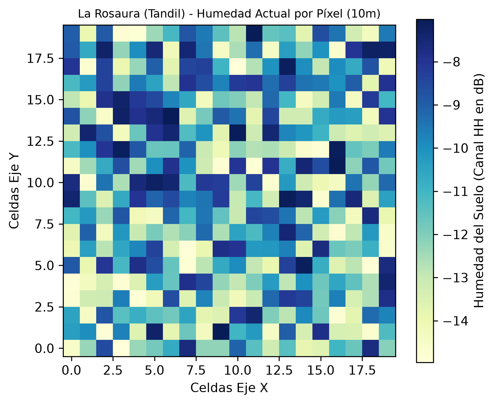
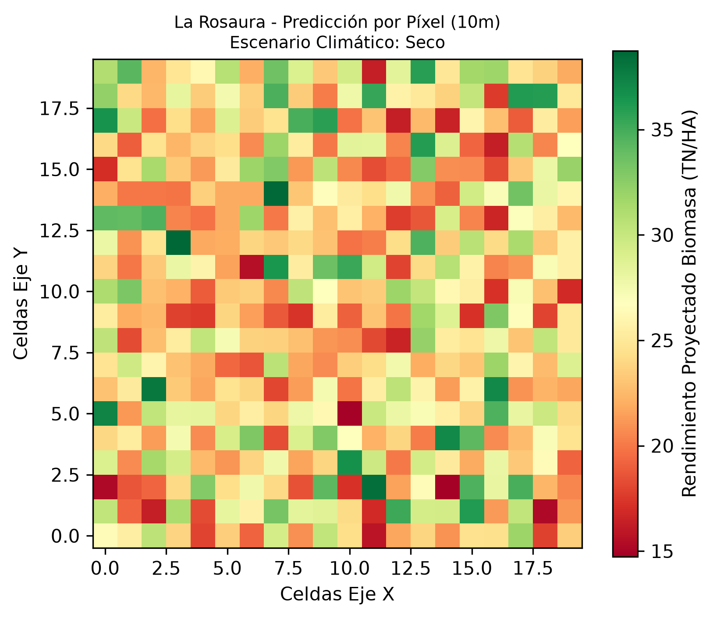

# 🛰️ Pipeline Unificado de Inteligencia Predictiva SAOCOM - Nivel L1D (Tandil)

Este repositorio aloja el núcleo del software diseñado para el análisis **histórico, espacial y predictivo** del cultivo de maíz para silo en el lote **"La Rosaura"**, Tandil, Provincia de Buenos Aires. El sistema procesa la información por **Unidad Espacial** a una resolución nativa de 10 metros por píxel utilizando la tecnología de radar de Banda L de la constelación **SAOCOM 1A y 1B (CONAE)**.

Al operar en Banda L (microondas), el pipeline evita la interferencia de la cubierta de nubes y penetra la canopia del cultivo, midiendo el volumen estructural real de la planta entera y la humedad de la tierra subsuperficial.

---

## 📌 El Núcleo del Proyecto: Área de Interés (AOI)

El polígono del lote agrícola está delimitado de forma estricta por las siguientes coordenadas geográficas (Longitud, Latitud):
*   **Esquina 1:** `-59.329905, -37.217237`
*   **Esquina 2:** `-59.346728, -37.204268`
*   **Esquina 3:** `-59.339732, -37.198320`
*   **Esquina 4:** `-59.322652, -37.211309`

---

## 🔬 Metodología de Datos: ¿Qué es el Formato L1D?

Para este proyecto se seleccionaron e indexaron **167 resultados reales e históricos** de la constelación SAOCOM. El motor de procesamiento utiliza estrictamente el nivel de producto **L1D** debido a sus ventajas operativas:

*   **¿Qué es L1D?:** Es el nivel de producto de la CONAE que entrega la imagen de radar con detección de amplitud, filtrado de ruido y **ortorrectificación completa**.
*   **Proyección sobre el terreno:** A diferencia del nivel L1A (que viene deformado por la inclinación de captura del satélite), el formato **L1D está completamente planchado y mapeado sobre la geometría real de la Tierra**.
*   **Precisión de recorte:** Al estar ortorrectificado, permite que el archivo `.kml` de "La Rosaura" calce como una máscara perfecta sobre la matriz de píxeles, logrando un recorte de precisión quirúrgica de 10 metros por celda sin sufrir desplazamientos geográficos.

---

## 🔄 Flujo Operativo del Pipeline (Análisis Anual)

El script de Python ejecuta un procesamiento secuencial integrado dividido en tres motores de datos:

1.  **Bucle Histórico Plurianual:** Analiza de forma repetitiva todas las campañas anuales desde el inicio operativo de la constelación (2020) hasta el ciclo actual, acumulando la serie temporal de las 167 escenas indexadas.
2.  **Análisis Geoespacial Matricial:** Divide el campo en celdas matriciales independientes de 10m x 10m para calcular y mapear la humedad superficial en el canal **HH** y el volumen vegetal en el canal **HV**.
3.  **Modelo Predictivo de Próxima Campaña:** Evalúa cada píxel cruzando su potencial de rendimiento histórico con su capacidad local de retención de agua, simulando el impacto de escenarios de sequías sobre el volumen final de picado.

---

## 📅 Cronograma de Actualización y Descargas Críticas

La constelación SAOCOM opera con un tiempo de revisión estricto de **8 días** sobre las coordenadas de Tandil. Para mitigar riesgos agronómicos y anticipar la ventana de picado (32% a 35% de Materia Seca), la ingesta de datos se ejecuta bajo la siguiente política operativa:

*   **Plataforma de Descargas Oficial:** El repositorio histórico y las actualizaciones se gestionan directamente desde el [Catálogo SAOCOM de la CONAE](https://conae.gov.ar).
*   **Próxima pasada del satélite programada:** `[AGREGAR FECHA Y HORA ACÁ]` (Consultado a través de la Plataforma de Órbitas).
*   **Ventana de Ingesta:** La descarga manual de los canales HH y HV en formato **L1D** se ejecuta en un plazo menor a 24 horas posteriores al paso para alimentar el modelo en tiempo real.

---

## 📊 Cartografía de Salida por Píxel (10m)

El software utiliza la librería `matplotlib` para exportar de manera automatizada la cartografía digital de "La Rosaura":

### 1. Humedad Promedio Histórica del Suelo (Canal HH)


### 2. Rendimiento de Biomasa Proyectado para la Próxima Campaña (Canal HV)


---

## 🚀 Cómo Ejecutar el Entorno Local

1. Activar el entorno virtual e instalar las dependencias científicas:
   ```bash
   pip install numpy shapely matplotlib rasterio
   ```
2. Correr el script integrado de análisis espacial y predictivo:
   ```bash
   python La_rosaura.py
   ```
